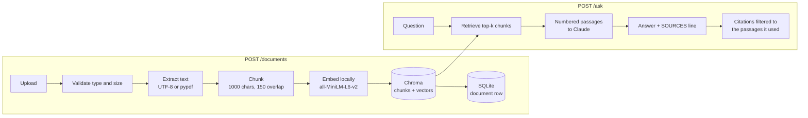

# askdocs

askdocs answers questions over your own `.txt`, `.md`, and `.pdf` files, and every answer cites the
passages it was built from. Documents, embeddings, and metadata stay on local disk; only the
passages retrieved for a question are sent to Claude.

It is a FastAPI service with a small web UI and a CLI on top of the same HTTP API.

## How it works



- **Chunking.** Text is split into fixed 1000-character windows that advance by 850, so neighbouring
  chunks overlap by 150 characters. These are constants in `app/services/chunking.py`, not
  settings. Each chunk keeps its character offsets and is stored in Chroma as
  `{document_id}:{index}`.
- **Citations come from the model's own source list.** Retrieved passages are numbered in the
  prompt, and Claude is told to answer only from them and to finish with `SOURCES: 1, 3` or
  `SOURCES: none`. askdocs strips that line and returns citations only for the passages it names.
  If the line is missing or names no valid passage, every retrieved passage is returned instead.
- **When nothing answers the question.** With no documents indexed, `/ask` returns `200`, a fixed
  message, and no citations, without calling Claude. With documents indexed, the top-k passages are
  always sent (there is no similarity cutoff), and the prompt tells Claude to say the documents do
  not contain the answer and reply `SOURCES: none`, which yields an empty citation list.
- **Embeddings are local.** Chroma's bundled `all-MiniLM-L6-v2` runs on ONNX Runtime and is
  downloaded once on first use. `EMBEDDING_MODEL` can point at a sentence-transformers model
  instead; changing it after indexing requires re-uploading documents.
- **Auth.** Off by default. When `API_KEY` is set, every documents and ask route requires a matching
  `X-API-Key` header, compared in constant time. `GET /health` and the web UI stay open.
- **Errors.** Every non-2xx response is `{"error": {"code": "...", "message": "..."}}` with a stable
  snake_case code (`unsupported_file_type`, `file_too_large`, `model_api_error`, ...). Stack traces
  go to the JSON log, never to the client. Responses carry an `X-Request-ID` that matches the
  request's `request_handled` log line.

The reasoning behind these choices is in [docs/decisions.md](docs/decisions.md).

## Quickstart

Requires Python 3.11+, [uv](https://docs.astral.sh/uv/), and an Anthropic API key.

```bash
git clone https://github.com/thealirazadev/askdocs.git
cd askdocs
cp .env.example .env        # set ANTHROPIC_API_KEY
uv sync
uv run uvicorn app.main:app --host 127.0.0.1 --port 8000
```

The web UI is at `http://127.0.0.1:8000/` and the OpenAPI docs at `http://127.0.0.1:8000/docs`.

Index a file and ask about it:

```bash
curl -F "file=@notes.md" http://127.0.0.1:8000/documents
# {"id": "3f2a...", "filename": "notes.md", "num_chunks": 4, "status": "indexed"}

curl -X POST http://127.0.0.1:8000/ask \
  -H "Content-Type: application/json" \
  -d '{"question": "What did we decide about the release date?"}'
# {"answer": "...", "citations": [{"document_id": "3f2a...", "filename": "notes.md",
#   "chunk_index": 2, "snippet": "...", "score": 0.71}]}
```

Add `-H "X-API-Key: $API_KEY"` to both when `API_KEY` is set.

The CLI talks to a running server:

```bash
uv run python -m cli.askdocs_cli add notes.md
uv run python -m cli.askdocs_cli list
uv run python -m cli.askdocs_cli ask "What did we decide about the release date?"
uv run python -m cli.askdocs_cli delete <document-id>
```

It reads `--base-url` / `ASKDOCS_URL` (default `http://127.0.0.1:8000`) and `--api-key` /
`ASKDOCS_API_KEY`.

## Configuration

Read from the environment or `.env` (see `app/config.py` and `.env.example`).

| Variable | Default | Purpose |
| --- | --- | --- |
| `ANTHROPIC_API_KEY` | (empty) | Key for the Claude API. Required for `/ask` to return answers. |
| `DATA_DIR` | `./data` | Holds the Chroma store (`chroma/`) and the SQLite database (`askdocs.db`). |
| `CLAUDE_MODEL` | `claude-opus-5-5` | Model used to compose answers. |
| `EMBEDDING_MODEL` | (empty) | sentence-transformers model to use instead of the bundled MiniLM. Requires the `sentence-transformers` package. |
| `API_KEY` | (empty) | When set, data routes require a matching `X-API-Key` header. |
| `MAX_UPLOAD_MB` | `10` | Upload size limit, enforced while the body is read. |
| `TOP_K` | `5` | Passages retrieved per question when the request does not set `top_k`. |
| `LOG_LEVEL` | `INFO` | Level for the JSON logger. |

## API

| Method | Path | Auth | Description |
| --- | --- | --- | --- |
| `GET` | `/health` | open | Liveness check, returns `{"status": "ok"}`. |
| `POST` | `/documents` | key if set | Multipart upload of one `.txt`, `.md`, or `.pdf` file. `201` with id and chunk count. |
| `GET` | `/documents` | key if set | Indexed documents, newest first. |
| `DELETE` | `/documents/{document_id}` | key if set | Removes the document and its chunks. `204`, or `404` if unknown. |
| `POST` | `/ask` | key if set | `{"question": str, "top_k": int?}` (question 1 to 2000 chars, `top_k` 1 to 20). Returns `answer` and `citations`. |
| `GET` | `/` | open | Web UI (static assets under `/web`). |

Request and response bodies and every error code are specified in
[docs/api-contracts.md](docs/api-contracts.md).

## Tests

```bash
uv run ruff check .
uv run black --check .
uv run pytest
```

Claude is mocked, so the suite needs no API key or network access to Anthropic. Chroma and
SQLite run for real against a temporary directory. CI runs all three on every push and pull
request and fails below 90 percent coverage. Details are in [docs/testing.md](docs/testing.md).

## Project layout

```
app/        FastAPI app: routers, services (extraction, chunking, embeddings, vector store,
            metadata, Claude client, answering), schemas, errors, logging, SQL migrations
cli/        HTTP client for add, list, delete, and ask
web/        Single static page: upload, ask, answer with citation chips
tests/      Unit and integration tests, PDF fixtures
docs/       Architecture, design decisions, API contracts, UI design, testing
```

## Design notes

[docs/architecture.md](docs/architecture.md) covers the pipeline, data model, and where state
lives. [docs/decisions.md](docs/decisions.md) records the decisions and why they were made.

## License

MIT. See [LICENSE](LICENSE).
